<p align="center">
  
</p>

<p align="center">
  <a href="https://github.com/ishandutta2007/Awesome-Awesome-Awesome"></a>
  <a href="https://discord.gg/jc4xtF58Ve"></a>
  <a href="https://github.com/ishandutta2007/Awesome-Video-Promotion-Platform/stargazers"></a>
  <a href="https://github.com/ishandutta2007/Awesome-Video-Promotion-Platform/network/members"></a>
  <a href="https://github.com/ishandutta2007/Awesome-Video-Promotion-Platform/blob/main/LICENSE"></a>
  <a href="https://github.com/ishandutta2007/Awesome-Video-Promotion-Platform/pulls"></a>
  <a href="https://github.com/ishandutta2007"></a>
</p>

---

# 🚀 Awesome Video Promotion Platform

> A curated directory of battle-tested **Video Promotion Platforms**, **Automated Video Distribution Pipelines**, **YouTube Growth Tools**, and **Open-Source Multi-Platform Video Syndication Engines**. Designed for content creators, growth marketers, indie hackers, and developers scaling organic reach and paid video campaigns.

---

## 📑 Table of Contents

- [🎯 Overview & SEO Insights](#-overview--seo-insights)
- [📊 Sector Overview & Market Dynamics](#-sector-overview--market-dynamics)
- [💼 SaaS & Commercial Promotion Platforms](#-saas--commercial-promotion-platforms)
- [🔓 Open-Source Repositories & Growth Tools](#-open-source-repositories--growth-tools)
- [🏗️ Architectural Blueprint: Building a Self-Hosted Pipeline](#️-architectural-blueprint-building-a-self-hosted-pipeline)
- [❓ Frequently Asked Questions (FAQ)](#-frequently-asked-questions-faq)
- [🤝 How to Contribute](#-how-to-contribute)
- [⚠️ Compliance & Disclaimer](#️-compliance--disclaimer)
- [💖 Support & Community](#-support--community)
- [📈 Star History](#--star-history)

---

## 🎯 Overview & SEO Insights

Video promotion has evolved beyond manual sharing. Modern digital marketing workflows leverage:

* **Official PPC & Programmatic Ad Delivery**: Algorithmic campaign bidding on YouTube (Google Ads), TikTok, and Meta.
* **Automated Cross-Platform Syndication**: Publishing one master video asset into tailored native short-form and long-form formats across YouTube Shorts, Instagram Reels, TikTok, X (Twitter), LinkedIn, and Bluesky.
* **AI-Assisted SEO & Metadata Optimization**: Dynamic title ideation, chapter timestamps, contrast-aware thumbnail generation, and SERP keyword ranking.
* **Open-Source Self-Hosted Pipelines**: Removing third-party SaaS middleman fees, avoiding vendor lock-in, and securing API keys and tokens locally.

---

## 📊 Sector Overview & Market Dynamics

* **Estimated Market Size**: The global video advertising and video marketing software market is estimated at **$190B to $240B**, with creator-economy promotion software and automated social publishing tools specifically capturing **$25B to $35B**, expanding at a projected CAGR of **18%–22%**.
* **Market Concentration & Dynamics**: The sector is **bifurcated and moderately fragmented**. Top-of-funnel programmatic video reach and ad inventory display are heavily concentrated in a winner-take-most duopoly (Google/YouTube and Meta), while creator-facing optimization tools, AI repurposing pipelines, cross-platform schedulers, and independent distribution agencies represent a **highly fragmented long-tail ecosystem** characterized by rapid experimentation, low switching costs, and rising demand for open-source data ownership.

---

## 💼 SaaS & Commercial Promotion Platforms

The table below catalogs leading commercial video promotion tools, YouTube advertising campaign managers, and creator marketing suites. Sorted by company scale in descending order:

| 🏷️ Platform | 🎯 Focus & Category | 💰 Pricing (Starting Tier) | 🎁 Free Tier / Trial Limits | 🏢 Company Scale (Revenue / Valuation) |
| :--- | :--- | :--- | :--- | :--- |
| **[YouTube Ads](https://ads.google.com/)** | Native PPC ad network across YouTube & Google Display (In-feed, In-stream, Shorts ads) | **$10.00** minimum billing threshold / **$5.00/day** recommended daily budget ($0.01–$0.04 avg CPV) | **$500 ad credit match** upon spending initial $500 within 60 days (0 free views without ad spend) | **~$307B+ Revenue** / **~$2.2T Valuation** (Alphabet Inc. Parent) |
| **[VidIQ](https://vidiq.com/)** | AI YouTube SEO, keyword search volume, competitor monitoring & channel audits | **$10.00/month** (Pro plan, billed annually at $120/yr) or **$19.00/month** (monthly) | **Free forever plan** (3 AI daily video ideas, basic keyword search, 3 competitor channel trackers) | **~$25M–$35M Revenue** / **~$100M+ Valuation** |
| **[TubeBuddy](https://tubebuddy.com/)** | YouTube channel management suite, bulk card/end-screen editor & thumbnail A/B testing | **$3.99/month** (Pro plan, billed annually at $47.88/yr) or **$6.00/month** (monthly) | **Free forever plan** (3 tag explorer search terms/day, basic channel health audit, limited bulk processing) | **~$15M–$25M Revenue** / **~$40M+ Valuation** (Acquired by BENlabs) |
| **[Prodvigate](https://prodvigate.com/)** | Automated Google Ads campaign manager specialized in YouTube channel promotion | **$49.00/week** minimum recurring campaign budget | **0 free campaign views** (No free trial; free channel audit & targeting setup in dashboard) | **~$8M–$12M Revenue** / **~$30M Valuation** |
| **[Sprizzy](https://sprizzy.com/)** | Targeted YouTube ads engine with Auto-Promote queue for new uploads & Shorts | **$50.00** minimum one-time campaign budget (~$0.02–$0.05 per targeted view) | **No general free trial** (Free channel analysis only; promotional ad credit requires proof of $500+ spend on another ad platform or tech review channel status) | **~$6M–$10M Revenue** / **~$25M Valuation** |
| **[Media Mister](https://mediamister.com/)** | Multi-network social promotion and video engagement packages (YouTube, TikTok, Instagram) | **$2.00** starting package (e.g. 50–100 targeted video views or likes) | **Free trial sample** of 50 views/likes without credit card; free browser-based engagement calculators | **~$5M–$8M Revenue** / **~$15M Valuation** |
| **[Promolta](https://promolta.com/)** | Targeted video distribution across external publisher websites, blogs, and mobile apps | **$10.00** minimum campaign deposit (pay-as-you-go per view) | **0 free views** (No free trial; free audience targeting and reach simulator dashboard access) | **~$3M–$6M Revenue** / **~$12M Valuation** |
| **[Rulta](https://rulta.com/)** | Creator copyright defense, automated DMCA takedowns, anti-piracy & video brand protection | **$139.00/month** (Pro plan for 1 username with unlimited automated DMCA notices) | **3-day free trial** (Capped at 20 URL takedowns/day, 1 manual request/day, 10 reverse image searches; credit card required) | **~$3M–$5M Revenue** / **~$12M Valuation** |
| **[VeeFly](https://veefly.com/)** | Official YouTube partner ad promoter with keyword targeting and subscriber acceleration | **$10.00** minimum initial campaign spend | **$10 free ad credit matching** first $10 deposit for new accounts (0 free views without deposit) | **~$2M–$4M Revenue** / **~$8M Valuation** |
| **[Melboss](https://melboss.com/)** | Music video marketing, cross-platform audience insights, and promotional campaign management | **$12.90/month** (or **$129.90/year** annual billing) | **30-day free trial** with full dashboard access, smart music plan, and artist showcase landing page | **~$1.5M–$3M Revenue** / **~$6M Valuation** |
| **[Video Promotion Club](https://videopromotion.club/)** | Music video and creator distribution across display ads and partner media sites | **$30.00** minimum starting promotional package (~1,000 views) | **0 free trial views** (Occasional 10%–15% promotional discount coupons only) | **~$1M–$3M Revenue** / **~$5M Valuation** |
| **[Viboom](https://viboom.com/)** | Native video advertising across social media communities and web partner networks | **$30.00** minimum package (1,000 views at ~$0.03/view) | **0 free trial views** (Free campaign configuration wizard & audience preview only) | **~$1M–$2M Revenue** / **~$4M Valuation** |
| **[ViewGrip](https://www.viewgrip.net/)** | Community-driven traffic exchange platform for YouTube engagement (views, likes, comments) | **$9.00/month** (Silver Plan) or **$4.99** coin packs (or **$0.00** via reciprocal worker) | **Free forever community plan** (Unlimited coin earning by watching/liking peer videos; max 3 active concurrent campaigns; 60-second viewing cap per exchange task) | **~$500K–$1M Revenue** / **~$2M Valuation** |

---

## 🔓 Open-Source Repositories & Growth Tools

Curated open-source projects for automated publishing, video SEO, campaign generation, and headless distribution pipelines. **Sorted in descending order by GitHub Stars**:

* **[Postiz](https://github.com/gitroomhq/postiz-app)** [](https://github.com/gitroomhq/postiz-app/stargazers)  
  *The ultimate open-source agentic social media scheduling and publishing platform.* Supports scheduling and auto-publishing videos to YouTube, TikTok, Instagram, X (Twitter), LinkedIn, Threads, and Pinterest with an AI assistant, team workspaces, and analytics.

* **[social-auto-upload](https://github.com/dreammis/social-auto-upload)** [](https://github.com/dreammis/social-auto-upload/stargazers)  
  *Automated multi-platform video uploading pipeline.* Automatically publishes videos simultaneously across YouTube, TikTok, Bilibili, Douyin, Xiaohongshu, and WeChat Channels using headless browser automation and official API integrations.

* **[Mixpost](https://github.com/inovector/mixpost)** [](https://github.com/inovector/mixpost/stargazers)  
  *Self-hosted social media management and video distribution engine.* Open-source Buffer and Hootsuite alternative. Schedule, publish, and track video content across YouTube, TikTok, Facebook, Instagram, LinkedIn, and Mastodon without monthly subscription fees.

* **[youtube-upload](https://github.com/tokland/youtube-upload)** [](https://github.com/tokland/youtube-upload/stargazers)  
  *Command-line script for batch uploading and scheduling videos to YouTube via the official YouTube Data API v3.* Features category selection, privacy options, automated playlist assignment, and scheduling.

* **[video-autopilot-kit](https://github.com/Hao0321/video-autopilot-kit)** [](https://github.com/Hao0321/video-autopilot-kit/stargazers)  
  *End-to-end automated framework for YouTube and short-form video generation & publishing.* Combines CapCut JSON templates, FFmpeg assembly tooling, and automated questionnaire scripts with zero telemetry or private data leakage.

* **[easy-uploader](https://github.com/wanghaisheng/easy-uploader)** [](https://github.com/wanghaisheng/easy-uploader/stargazers)  
  *Bulk video uploader and scheduling system for creators and marketing teams.* Enables batch headless uploading and scheduled syndication across all major video networks to maximize organic leads.

* **[vast-client-js](https://github.com/dailymotion/vast-client-js)** [](https://github.com/dailymotion/vast-client-js/stargazers)  
  *High-performance JavaScript VAST (up to VAST 4.2) parser and programmatic ad-serving client.* Developed by Dailymotion for serving linear and non-linear video advertisements across HTML5 players.

* **[Open-AI-UGC](https://github.com/Anil-matcha/Open-AI-UGC)** [](https://github.com/Anil-matcha/Open-AI-UGC/stargazers)  
  *Self-hosted AI UGC video ad generation studio.* Open-source alternative to Arcads and MakeUGC. Generates high-converting promotional ads and video hooks featuring AI actors powered by Veo 3.1, Seedance 2, Grok Video, and Happy Horse.

* **[youtube-marketing-skills](https://github.com/adityaarsharma/youtube-marketing-skills)** [](https://github.com/adityaarsharma/youtube-marketing-skills/stargazers)  
  *Open-source agent-agnostic YouTube growth toolkit.* Ships 21 AI commands and a live channel Model Context Protocol (MCP) server. Delivers competitor gap analysis, keyword volume tracking via DataForSEO MCP, title/thumbnail ideation, and WordPress post generation.

* **[youtube-skills](https://github.com/sergebulaev/youtube-skills)** [](https://github.com/sergebulaev/youtube-skills/stargazers)  
  *YouTube and YouTube Shorts marketing skills for Claude Code and Codex.* Crafts high-CTR titles, SEO-optimized descriptions with timestamps, audience retention hooks, and multi-week editorial calendar sequencing.

* **[claude-video](https://github.com/AgriciDaniel/claude-video)** [](https://github.com/AgriciDaniel/claude-video/stargazers)  
  *AI-powered video production suite for Claude Code.* Full pipeline covering video transcoding, contrast-aware captions, stock footage promo generation, and single-command export presets tailored for YouTube, TikTok, Instagram, and LinkedIn.

* **[ai-social-agent](https://github.com/Nuraveda/ai-social-agent)** [](https://github.com/Nuraveda/ai-social-agent/stargazers)  
  *Multi-brand social video AI agent.* Scans trend signals, drafts platform-tailored scripts, renders short-form videos via pluggable providers (Kling, Veo, fal.ai), and enforces a human-in-the-loop approval gate before publishing to YouTube Shorts, Instagram Reels, and X/Twitter.

* **[socialdrop](https://github.com/txrbgy/socialdrop)** [](https://github.com/txrbgy/socialdrop/stargazers)  
  *Local-first folder-based video publishing pipeline.* Watches a local folder, reads companion markdown metadata and scheduled dates, and publishes through official APIs to YouTube, TikTok, Instagram, X, LinkedIn, and Bluesky while storing credentials securely in the OS keyring.

* **[YouTube-Virtual-Manager](https://github.com/Build4Build/YouTube-Virtual-Manager)** [](https://github.com/Build4Build/YouTube-Virtual-Manager/stargazers)  
  *Desktop YouTube channel management and analytics optimizer.* Electron and React dashboard connecting with YouTube API and OpenAI to analyze channel statistics, pinpoint underperforming videos, and recommend growth actions.

---

## 🏗️ Architectural Blueprint: Building a Self-Hosted Pipeline

For engineering teams seeking complete data sovereignty without ongoing SaaS subscription fees, combine these open-source building blocks into a unified workflow:

```
┌────────────────────────┐      ┌──────────────────────────┐      ┌─────────────────────────┐
│   Idea & SEO Research  │ ───► │  Production & Assembly   │ ───► │   Approval & Staging    │
│youtube-marketing-skills│      │ claude-video / FFmpeg    │      │ ai-social-agent Review  │
└────────────────────────┘      └──────────────────────────┘      └─────────────────────────┘
                                                                               │
                                                                               ▼
┌────────────────────────┐      ┌──────────────────────────┐      ┌─────────────────────────┐
│  Performance Tracking  │ ◄─── │ Multi-Channel Publishing │ ◄─── │  Scheduled Dispatcher   │
│ YouTube-Virtual-Manager│      │ Postiz / socialdrop      │      │ easy-uploader           │
└────────────────────────┘      └──────────────────────────┘      └─────────────────────────┘
```

1. **Ideation & SEO Strategy**: Use [youtube-marketing-skills](https://github.com/adityaarsharma/youtube-marketing-skills) with MCP to pinpoint low-competition, high-volume video topics.
2. **Video Assembly**: Render video assets with [claude-video](https://github.com/AgriciDaniel/claude-video) or programmatic Remotion templates.
3. **Guardrails & Approval**: Pass outputs through [ai-social-agent](https://github.com/Nuraveda/ai-social-agent) with human approval checkpoints.
4. **Autonomous Distribution**: Feed final media into [Postiz](https://github.com/gitroomhq/postiz-app) or [socialdrop](https://github.com/txrbgy/socialdrop) to publish across YouTube Shorts, TikTok, and Instagram simultaneously.
5. **Audience Feedback Loop**: Audit metrics through [YouTube-Virtual-Manager](https://github.com/Build4Build/YouTube-Virtual-Manager) to continuously refine future releases.

---

## ❓ Frequently Asked Questions (FAQ)

### 1. What is the difference between PPC video promotion and traffic exchange networks?
PPC platforms (such as **YouTube Ads / Google Ads**, **Sprizzy**, and **Prodvigate**) place your videos as real advertisements before or alongside related content, targeting viewers based on explicit search intent, demographics, and interests. In contrast, traffic exchange platforms (like **ViewGrip**) rely on reciprocal viewing networks where users watch each other's videos to earn credits. PPC views represent prospective organic viewers, whereas traffic exchanges prioritize raw view counts.

### 2. Is automated video promotion compliant with YouTube’s Terms of Service?
Promotion through official advertising APIs and syndication tools (e.g., [Postiz](https://github.com/gitroomhq/postiz-app), [socialdrop](https://github.com/txrbgy/socialdrop), Google Ads) is 100% compliant. However, services deploying automated view bots, fake engagement farms, or artificial subscriber spikes violate Section 4 of YouTube’s Terms of Service and risk channel demonetization or permanent termination.

### 3. Why choose an open-source video publishing pipeline over commercial SaaS tools?
Open-source pipelines offer three key advantages:
* **Cost Efficiency**: Eliminates per-channel or per-post monthly subscriptions (such as $50–$200/mo charged by social suites).
* **Data Privacy & Security**: Your OAuth API tokens and video assets remain on your local disk or personal cloud rather than third-party servers.
* **Custom Extensibility**: You can integrate custom AI agents, automated watermarking, and programmatic transcoding workflows tailored to your brand.

---

## 🤝 How to Contribute

Contributions to this ecosystem are warmly welcomed! To suggest a new tool or update existing entries:

1. 🍴 Fork the repository.
2. 📝 Add your entry under either the SaaS table or Open-Source section following the existing formatting guidelines.
3. 🔎 Verify that pricing, free tier limits, and URLs are accurate and up to date.
4. 🚀 Submit a pull request with a descriptive title and rationale.

Please check our parent awesome list at **[Awesome-Awesome-Awesome](https://github.com/ishandutta2007/Awesome-Awesome-Awesome)** for related developer resources!

---

## ⚠️ Compliance & Disclaimer

* This repository is an independently curated community resource and is not affiliated with Google LLC, YouTube, TikTok, or Meta.
* All trademarks and brand names belong to their respective holders.
* Users are responsible for complying with the advertising guidelines, API quotas, and terms of service of each target platform.

---

## 💖 Support & Community

If you find this repository valuable for discovering video promotion platforms and open-source growth infrastructure, please consider supporting the project:

- ⭐ **Star this repository** on GitHub to help more creators and developers discover it.
- 🍴 **Fork it** and contribute your favorite automation scripts or distribution tools.
- 📢 **Share it** with your network across X, LinkedIn, Discord, and Reddit.
- ☕ **Sponsor the Maintainer**: [Support via GitHub Sponsor Dashboard](https://github.com/sponsors/ishandutta2007) to keep the project maintained.

---

##  Star History

[](https://star-history.com/#ishandutta2007/Awesome-Video-Promotion-Platform&type=date&legend=top-left)

---

<p align="center">
  <b>Built with ❤️ for Content Creators, Video Marketers &amp; Open-Source Engineers Worldwide.</b>
</p>
